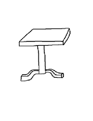

# Jake Sinclair Render

## Concept

A "bar table" made mainly of wood with some metal fittings and a glass tabletop.

## Design

I looked around online for inspiration on different types of bar tables and settled on a style like:

The tabletop would be a square, supported by a single central column atop 4 curved feet.

## Methodology

Created the basic shapes with primitives.

Stylised the model with curved edges and bevels, made the top face of the table be inset so the glass sits more flush.

Made "wear and tare" on the surface of the feet with primitives and a boolean modifier.
